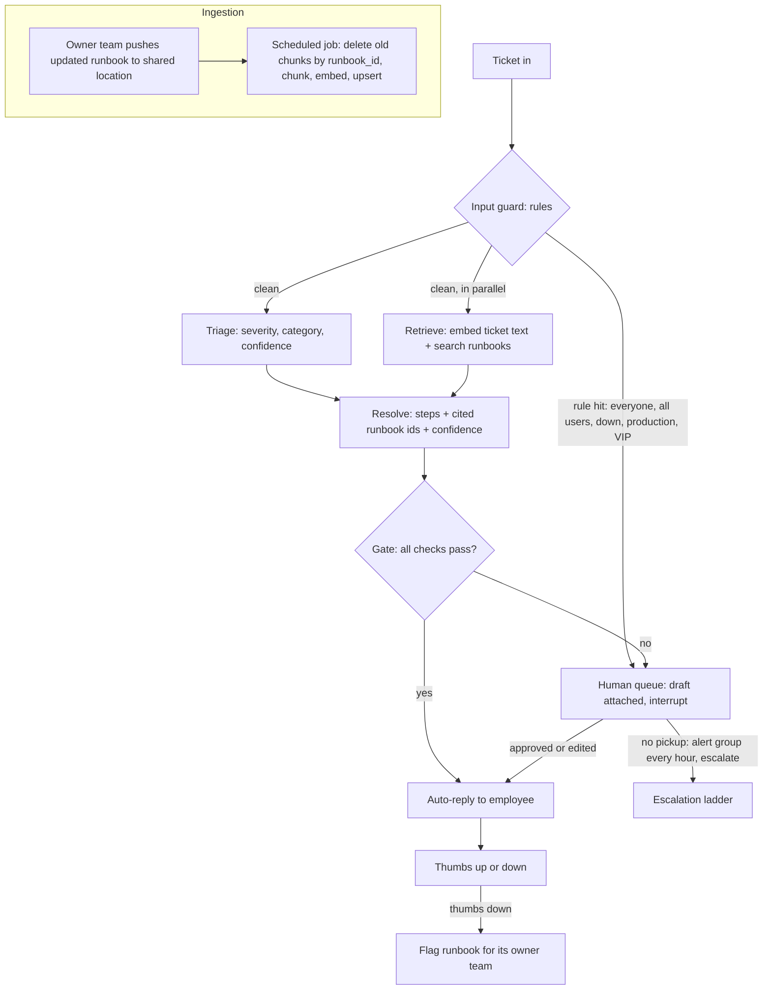

# customer-support agent

> DRAFT written by Claude from Hemasai's spoken answers on 4 Nov 2026. Items marked **OPEN** are not decided yet. Ownership check: redraw this on paper on Fri 6 Nov with the file closed, then say the 3 trade-offs aloud. Rewrite in your own words anything you cannot defend.

## What it does (2 lines) + who uses it + how many users/tickets
An internal IT support agent. It reads an employee's ticket, works out its severity and category, finds matching runbooks, and writes resolution steps with the runbooks it used. Safe, low-risk answers go straight to the employee; everything else waits for a human to approve before the employee sees it.

- Users: employees in India, tickets raised in a 9-hour window (32,400 s).
- Volume: **5,000 tickets a day** = 0.154 per second on average (about one ticket every 6.5 s). At 10x peak: **1.54 per second** (about 92 a minute). Design target: **3 to 4 per second** (about 2x headroom over the peak).
- In flight at once (rate x time per ticket, about 7 s): about 11 at peak, about 28 at the design target. This is the number that sizes model rate limits and compute concurrency.
- Human queue: about **500 tickets a day (10%)**: 250 high or critical severity, 100 needing an admin action, 150 failing the confidence or citation checks. At about 10 min each that is about 83 agent-hours a day (about 10 people); at about 5 min each (approve or edit a draft) about 42 hours (about 5 people). These shares are guesses; replace them with counts from the golden set and a pilot.

## Diagram (boxes and arrows: ticket -> ... -> answer)

State saved after every node (checkpointer): `ticket`, `triage`, `retrieved_chunks`, `resolution`, `needs_human`, `error`. The pause at the human queue is a LangGraph `interrupt`; the run resumes when the human approves, even after hours.

**Auto-reply gate (all must be true):** severity is low or medium, AND every step is self-service (the employee does it alone on their own device), AND triage and resolve confidence are above their thresholds, AND every cited runbook id was actually retrieved, AND no input rule hit, AND the runbook is not flagged as stale. Anything else goes to a human with the draft attached. Thresholds start as guesses and are chosen later by measuring wrong auto-replies on the golden set.

**OPEN:** who decides that a step is "admin action" vs "self-service"? Options: a `step_type` tag on each runbook, or the resolve call labels each step. Pick one and say what happens when the label is wrong.

## 3 trade-offs: chosen vs REJECTED alternative, one line why
1. **A fixed graph** vs **one agent with tools**, because the human approval must be a hard edge in code that the model cannot skip or talk its way around, every step can be tested on its own, and cost and latency are bounded. Pausing is not the difference: both can pause if state is saved by a checkpointer. Cost: new cases need a code change instead of the model improvising.
2. **Two model calls (triage, then resolve)** vs **one call that does both**, because triage output (severity, category, confidence) can gate before the expensive call, triage can run on a small cheap model, and triage can run in parallel with retrieval, which one combined call cannot. Cost: about 1 s extra, the ticket text is sent twice, and the two calls can disagree.
3. **Hybrid: auto-reply low-risk, human approval for the rest** vs **auto-reply everything** (one wrong admin step does real damage) or **human for everything** (about 5,000 tickets a day in the queue, no time saved). Cost: about 500 tickets a day need people, a risk gate to maintain, and thresholds to tune.

Also decided: retrieval runs in parallel with triage by searching with the raw ticket text. Cost: no category filter on the search, so a ticket cannot be narrowed to one category's runbooks.

## 3 failure cases: what breaks -> how you notice -> what you do
1. **Stale runbook (steps out of date)** -> the runbook owner team is the source of truth; a negative thumbs-down on a ticket answered from a runbook counts against that runbook and triggers a check (is the runbook wrong, or did the model hallucinate?); **OPEN:** also store `last_reviewed` and `owner` on each runbook and flag old ones -> the scheduled job re-indexes pushed updates and deletes the old chunks by `runbook_id` (otherwise old and new chunks sit side by side); a flagged runbook makes its tickets go to a human instead of auto-reply.
2. **A real critical ticket labelled "low"** -> input rules catch words like "everyone", "all users", "down", "production"; the confidence threshold and the citation check catch weak answers; **known gap:** a confident wrong label with valid citations passes every check, so sample a few auto-replied tickets each week for review and track thumbs-down on auto-replies -> rule hits go to a human; a drop in the audit score tightens the thresholds.
3. **Human never answers** -> track age in queue per ticket; critical and high alert the human group every hour; medium every 2 hours (**OPEN:** confirm "every other 1 hour") -> escalate to the group, then to the manager. **OPEN, not decided yet:** send the employee an acknowledgement the moment the ticket is queued; first-alert timers per severity shorter than 1 hour for critical; escalation clocks that run on business hours, because a ticket queued at 5 PM would otherwise escalate overnight.

## Rough cost + latency (one number each, say how you got it)
These are estimates, not measurements. Prices are assumed Nova Micro prices (about $0.035 per million input tokens, $0.14 per million output tokens); check the AWS pricing page before quoting them.

- **Latency: about 7 s per ticket on your guesses, about 6 s if the rule-based guard takes 0.1 s.** Guard 1 s + (triage 1 s in parallel with embed + search 2 s, so the slower branch, 2 s) + resolve 4 s. Sequential it was 8 s, exactly the budget. The p95 is worse than this typical number, so measure it (Wk12). Time one real Nova call from the capstone to replace the resolve guess.
- **Cost: about $0.72 a day, about $22 a month, for model calls.** Per ticket about 2,500 input tokens and 400 output tokens across both calls: 5,000 x 2,500 = 12.5M input tokens x $0.035 = $0.44, plus 5,000 x 400 = 2M output tokens x $0.14 = $0.28. Embedding is cents. This is a claude-written estimate: check it against real token counts in your usage logging. The people cost (about 5 to 10 agents in the queue) is far larger than the model cost.
