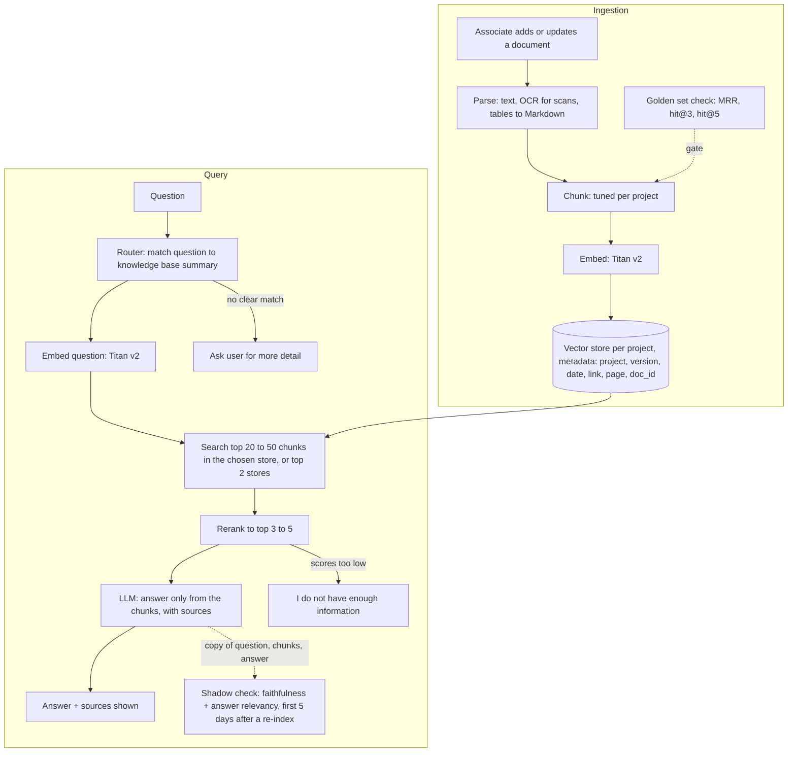

# document Q&A

## What it does (2 lines) + who uses it + how many users/docs
An internal chatbot that answers employee questions about HR, health insurance, software and laptop guidelines, and project policies, using only the company's own documents, and shows which document each answer came from. If the documents do not cover the question it says so instead of guessing.

- Users: 10,000 employees, 4,000 (40%) use it daily, 2 questions each, so about **8,000 questions a day** (about 0.3 per second on average, about 1 per second at peak).
- Documents: about **1,000 documents**, one knowledge base (vector store) per project or business unit.

## Diagram (boxes and arrows: client -> ... -> answer)

The shadow check runs off to the side, so the user never waits for it. After 5 days with good scores and no accuracy complaints, it is switched off for that knowledge base.
Hybrid (keyword + vector) search is switched on per project where exact codes and names matter; plain vector search elsewhere.

## 3 trade-offs: chosen vs REJECTED alternative, one line why
1. **One vector store per project** vs **one store with a project tag**, because each project has a different kind of content (some need hybrid search, chunking is tuned per project) and updates one project without touching the rest. Cost: a router is needed, and a wrong route means the right chunks are never searched.
2. **Persistent vector store** vs **in-memory store**, because it survives restarts without re-embedding, and the ingestion pipeline and the API can share it. RAM is not the reason: about 30,000 chunks x 1,024 numbers x 4 bytes is about 120 MB.
3. **Rerank the top 20 to 50 down to 3 to 5** vs **use the plain top 3 from similarity search**, because similarity search can put the right chunk 2nd or 3rd (G-28 in the capstone: right runbook ranked 2nd or 3rd behind a title chunk). Cost: one more call and a few hundred milliseconds.

## 3 failure cases: what breaks -> how you notice -> what you do
1. **Router picks the wrong knowledge base** -> log the router's scores for every question; notice when the top two scores are close or when users give thumbs-down on questions that fit another project -> search the top 2 stores and let the reranker merge, ask the user for more detail when there is no clear match, then fix the store summary or rewrite the query.
2. **Similar words but no real answer in the documents, so the model makes one up** -> low faithfulness scores in the 5-day shadow check after a re-index, then thumbs-down and user complaints once the check is off -> answer "I do not have enough information" when retrieval scores are too low, tell the model to answer only from the chunks, always show sources, and add the question to the failure set (the same habit as the retrieval entries in FAILURES.md). Known gap: after the shadow check is switched off, only thumbs-down and complaints catch this.
3. **Old policy version still being answered after an update** -> the source shown under each answer carries the version and date, and the ingestion job logs every failed upsert -> delete all chunks of the old version by `doc_id` and upsert the new one, and alert when an ingestion fails so the old version does not stay live.

## Rough cost + latency (one number each, say how you got it)
These are estimates, not measurements. Prices are assumed Nova Micro prices (about $0.035 per million input tokens, $0.14 per million output tokens); check the AWS pricing page before quoting them.

- **Latency: about 3.5 seconds per question.** Router 0.1 s + embed 0.1 s + search 0.05 s + rerank 0.3 s + answer LLM about 3 s. The answer LLM call is the slowest part. The shadow check runs off the response path, so it adds nothing for the user. Time one real Nova call from the capstone to replace the LLM guess.
- **Cost: about $0.90 a day, about $27 a month, for the answer calls.** 8,000 x 2,000 input tokens + 8,000 x 300 output tokens. Embedding is cents. The reranker is not included; its price needs checking.
- **Shadow check, first 5 days after a re-index of a knowledge base:** the faithfulness and relevancy check on every answer is about $1.50 a day at full traffic (8,000 x 3,000 input + 8,000 x 600 output), so about $7.50 for the 5 days. The rejected alternative is checking every answer forever, which would roughly double the monthly LLM cost and need a decision on what to do when the check fails after the user has already seen the answer.
