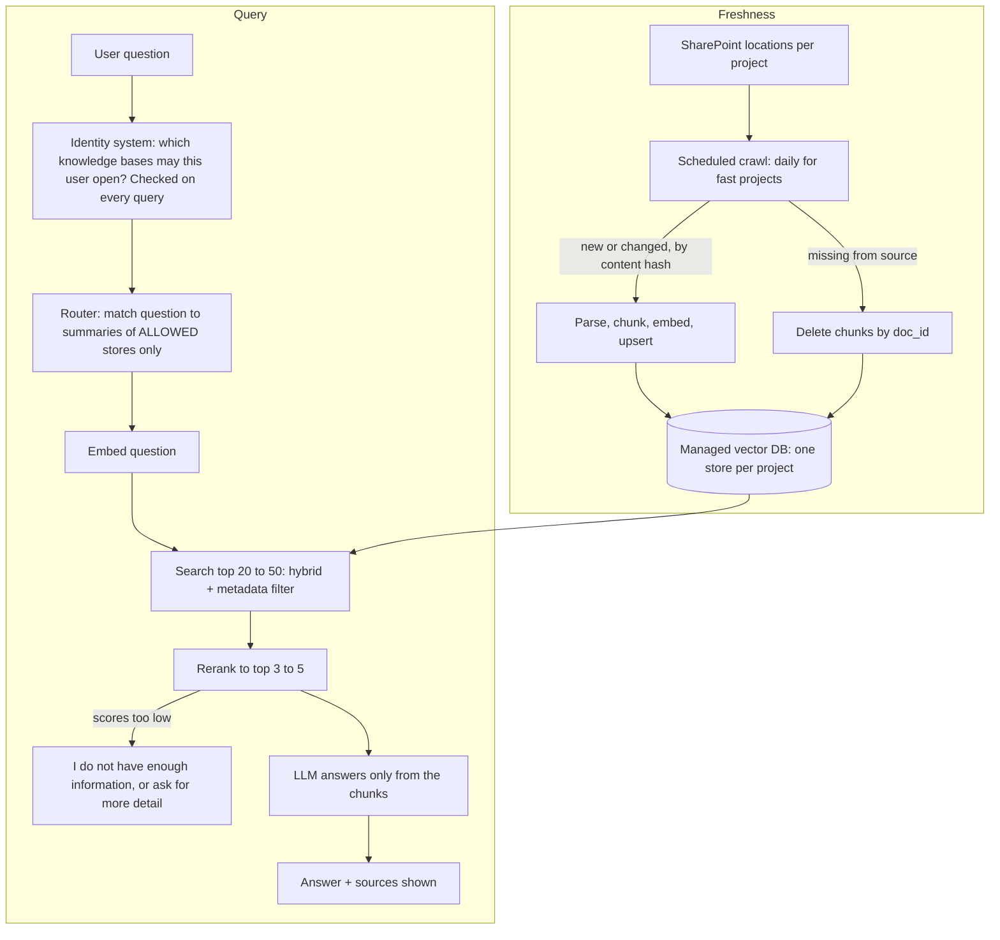

# enterprise search

## What it does (2 lines) + who uses it + how many users/docs
Searches and answers questions across many company sources (SharePoint locations, project knowledge bases) and shows the source of each answer, but only from knowledge bases the user is allowed to open. It is page 1 (document Q&A) plus access control, freshness and scale.

- Users: 10,000 employees, about 4,000 use it daily, **8,000 questions a day**.
- Documents: about **1,000,000 documents**, about 30 million chunks (assumption: 30 chunks per document), spread over many knowledge bases, one store per project.

## Diagram (boxes and arrows: client -> ... -> answer)

The permission check happens before any search, so a chunk from a store the user cannot open is never retrieved and never reaches the LLM.

## 3 trade-offs: chosen vs REJECTED alternative, one line why
1. **Permission check at the knowledge-base level, before search** vs **document-level permissions on every chunk, or filtering the results after the search**, because it is simple and a restricted chunk never reaches the LLM. Cost, accepted: everyone in a store can see every document in it, so documents with different audiences must go into different stores.
2. **Scheduled daily crawl** vs **event-driven updates pushed by each source**, because one crawl job works for every source, including ones that cannot send events, and it also detects deleted documents (a deletion sends nothing). Cost, accepted: a change or deletion can take up to 24 hours to show.
3. **Managed vector DB (OpenSearch or Pinecone)** vs **the local persistent store from page 1**, because about 30 million chunks x 1,024 numbers x 4 bytes is about 120 GB of vectors, which is too much for one machine's memory, and a managed store handles sharding and backups. Cost: a monthly bill and a service to operate.

## 3 failure cases: what breaks -> how you notice -> what you do
1. **A deleted or changed document is still quoted** until the next daily crawl -> the crawl log shows the time of the last successful run per project, and the answer shows the document version and date -> accepted up to 24 hours; if a crawl fails, alert the project owner and re-run; a project that needs fresher data gets a shorter crawl interval.
2. **A user who moved projects can still open the old project's knowledge base** because group membership is cached, for a day or a few days (accepted for internal moves; a person who leaves the company loses access at login) -> a periodic test with an account that was removed from a project, and a log of which stores each user queried -> keep the cache short, and move any store with truly sensitive content to a shorter cache.
3. **Near-duplicate chunks at scale crowd out the right one**, so the answer is wrong or repeats itself (the G-28 pattern from the capstone, made worse by 30 million chunks) -> hit@3 and MRR on a golden set per store drop after a re-index, plus thumbs-down -> metadata filters, hybrid search, dedupe near-identical chunks, rerank, and answer "I do not have enough information" when scores are below the threshold instead of fetching more chunks.

## Rough cost + latency (one number each, say how you got it)
These are estimates, not measurements. Prices are from memory and need checking on the AWS pricing page before quoting.

- **Latency: about 4 seconds per question.** Identity lookup 0.05 s (cached) + router 0.1 s + embed 0.1 s + search in the managed store 0.1 s + rerank 0.3 s + answer LLM about 3 s. The LLM call is the slowest part, same as page 1. Search stays fast at this size because the index is approximate, not a scan of all 30 million chunks.
- **Cost: about $90 once to embed the first 1,000,000 documents.** 30 million chunks x about 150 tokens = 4.5 billion tokens, at about $0.02 per million tokens (Titan v2, price to verify). After that only changed documents are embedded again, detected by a content hash. A full re-embed is needed only if the embedding model or the chunking changes. Answering costs about $0.90 a day, same as page 1.
- **Not priced:** the monthly cost of the managed vector store and the reranker. Check their pricing pages; the vector store is likely the largest recurring cost.
